# Comercial La Estrella
## Proyecto Fase 2 - Backend y Exposición de Servicios


## 1. Descripción

El proyecto cuenta con una API REST en Node.js (Express) sobre Microsoft SQL Server 2022 ejecutado en Docker. Las reglas de negocio críticas y los reportes analíticos viven en el motor de base de datos (2 triggers y 3 vistas). La API solo expone CRUD y consulta las vistas.

Ninguna operación de datos se hace conectándose directamente a la base: todo pasa por la API.

## 2. Estructura del proyecto

```
[BD1]_ProyectoFase2_202402955/
  docker-compose.yml        SQL Server 2022 + contenedor que ejecuta init.sql
  init.sql                  Tablas, llaves, 3 vistas y 2 triggers
  README.md
  Comercial_La_Estrella_postman_collection.json   Colección de pruebas
  capturas/                 Evidencias (triggers y vistas)
  backend/
    index.js                Servidor Express
    .env                    Variables de conexión
    config/db.js            Conexión a SQL Server (mssql)
    routes/index.js         Rutas por entidad, vistas y detalle de venta
    utils/crudFactory.js    CRUD genérico (GET, POST, PUT, DELETE y carga masiva)
    package.json
```

## 3. Requisitos del sistema

- Docker Desktop (con docker compose)
- Node.js 18 o superior (se probó con Node 24)
- Postman
- Puertos libres: 1433 (SQL Server) y 3000 (API)

## 4. Levantar la base de datos

Desde la carpeta raíz del proyecto:

```bash
docker compose up -d
```

Esto crea dos contenedores:

- `comercial_estrella_db`: SQL Server 2022 (usuario `sa`, contraseña definida en `docker-compose.yml`).
- `comercial_estrella_init`: ejecuta `init.sql` automáticamente y termina.

Para verificar que el script DDL se ejecuta:

```bash
docker logs comercial_estrella_init
```

Debe mostrar, sin errores:

```
Changed database context to 'ComercialLaEstrella'.
Esquema de 19 tablas creado correctamente
Vistas y triggers creados correctamente
```

Para reiniciar la base desde cero (borra todos los datos):

```bash
docker compose down -v
docker compose up -d
```

## 5. Ejecutar la API

En otra terminal, desde la carpeta `backend`:

```bash
cd backend
cp . env.example .env
npm install
npm start
```

Debe mostrar `Servidor corriendo en http://localhost:3000`. La conexión a la base se configura con variables de entorno en `backend/.env`:

```
DB_SERVER=localhost
DB_PORT=1433
DB_USER=sa
DB_PASSWORD=<la misma de docker-compose.yml>
DB_DATABASE=ComercialLaEstrella
PORT=3000
```

Si se reinicia la base de datos, hay que reiniciar también el backend para que se reconecte de forma correcta.

## 6. Endpoints

Todas las respuestas son JSON. Base: `http://localhost:3000/api`.

Entidades con CRUD completo: `paises`, `departamentos`, `municipios`, `tipos-tienda`, `cargos`, `tipos-identificacion`, `categorias`, `marcas`, `estados-venta`, `metodos-pago`, `tiendas`, `personas`, `productos`, `empleados`, `clientes`, `catalogo-producto`, `ventas`, `detalles-venta` y `pagos` (las 19 tablas).

| Método | Ruta | Descripción |
| --- | --- | --- |
| GET | `/api/<entidad>` | Lista todos los registros |
| GET | `/api/<entidad>/:id` | Busca un registro por su llave |
| POST | `/api/<entidad>` | Crea un registro |
| POST | `/api/<entidad>/bulk` | Carga masiva (arreglo JSON) en una sola transacción |
| PUT | `/api/<entidad>/:id` | Actualiza un registro |
| DELETE | `/api/<entidad>/:id` | Elimina un registro |

Las tablas con llave compuesta (`catalogo-producto` y `detalles-venta`) reciben las dos partes separadas por coma, por ejemplo `/api/catalogo-producto/1,5`.

Reportes (consultan las vistas, sin JOINs en el código de la API):

| Ruta | Vista |
| --- | --- |
| `GET /api/vista-ventas-ubicacion` | `Vista_Ventas_Ubicacion` |
| `GET /api/vista-top-productos` | `Vista_Top_Productos` |
| `GET /api/vista-saldos-pendientes` | `Vista_Saldos_Pendientes` |

## 7. Objetos programados en SQL Server

Vistas:

1. `Vista_Ventas_Ubicacion`: tienda, municipio, departamento, país, cantidad de ventas y total facturado, excluyendo las ventas anuladas.
2. `Vista_Top_Productos`: código, nombre, categoría, marca, unidades vendidas y monto generado, excluyendo las ventas anuladas.
3. `Vista_Saldos_Pendientes`: solo ventas en estado REGISTRADA, con total de la venta, total pagado y saldo pendiente.

Triggers:

1. `trg_Insert_Detalle` (sobre `DESGLOSE_VENTA`): usa la tabla `inserted` para comparar la cantidad pedida contra `existencia_actual` del catálogo de la tienda. Si no alcanza, hace `ROLLBACK TRANSACTION` y lanza el error 50001; la API lo captura y responde HTTP 400 con el mensaje `Stock insuficiente`. Si alcanza, descuenta la cantidad del inventario.
2. `trg_Insert_Pago` (sobre `PAGO`): suma todos los pagos de la venta y, si el total cubre o supera el total de la venta, cambia el estado de la venta de REGISTRADA a PAGADA.

## 8. Pruebas con Postman

1. Importar `Comercial_La_Estrella_postman_collection.json` (colección exportada desde Postman en formato Collection v2.1).
2. Dejar el entorno en "No Environment" (las variables `host` y `baseUrl` están dentro de la colección).
3. Partir de una base limpia (`docker compose down -v`, `docker compose up -d` y reiniciar el backend).
4. Ejecutar la colección completa con el Runner. Resultado esperado: 245 pruebas, todas correctas.

Carpetas de la colección:

- `00 - Carga inicial del dataset`: carga masiva de las 19 tablas y verificación de conteos.
- `01 - Preparación`: comprueba que la API está en línea y obtiene los ids de los estados de venta.
- `02 - CRUD`: crear, leer y actualizar en cada entidad.
- `03 - Triggers`: escenarios de validación.
- `04 - Vistas`: consulta de los 3 reportes.
- `05 - Carga masiva`: demostración de transacción (si un registro falla, se revierte todo).
- `06 - Manejo de errores`: cuerpo vacío, columna inexistente, JSON mal formado, duplicados, ids inexistentes y llaves foráneas inválidas.
- `07 - CRUD (eliminar y limpieza)`: elimina los registros creados durante las pruebas.

> **Nota:** la colección está pensada para correr sobre una base recién creada. Si se ejecuta dos veces seguidas sin reiniciar la base, la carpeta 00 fallará por registros duplicados.

## 9. Escenarios de validación de triggers

1. Inventario (fallo): POST a `/api/detalles-venta` con una cantidad mayor a la existencia. La API responde HTTP 400 con `Stock insuficiente` y la existencia del catálogo no cambia.
2. Inventario (éxito): POST con una cantidad válida responde HTTP 201; un GET posterior al catálogo muestra la existencia reducida.
3. Estado de venta: tres POST a `/api/pagos` con abonos parciales; la API solo responde que el pago fue registrado. Tras los dos primeros abonos la venta sigue REGISTRADA, al insertar el abono que cubre el total, un GET a la venta muestra PAGADA siendo un cambio hecho por el trigger.

## 10. Decisiones de diseño

- **Carga inicial en modo histórico:** el dataset de detalles de venta trae cantidades que superan la existencia del catálogo, por lo que con `trg_Insert_Detalle` activo se rechazarían. El endpoint `POST /api/detalles-venta/bulk?historico=true` desactiva los triggers de esa tabla solo durante la transacción de la carga y los vuelve a activar antes del commit. Todos los POST individuales mantienen los triggers activos.
- **Carga masiva transaccional:** cada `/bulk` inserta todo en una transacción, si un registro falla se revierte todo y la API responde 400 con el detalle.
- **Correo único con valores nulos:** en SQL Server, una restricción `UNIQUE` normal admite un solo NULL. Como varias personas no tienen correo, se usa un índice único filtrado (`WHERE correo IS NOT NULL`), que evita correos repetidos y permite varios NULL. Por eso `init.sql` activa `SET QUOTED_IDENTIFIER ON` antes de crearlo.
- **Las columnas de la tabla se consultan antes de abrir la transacción de la carga masiva:** `DISABLE TRIGGER` bloquea la tabla hasta el commit y una consulta de metadatos desde otra conexión quedaría esperando.

## 11. Evidencias

>**Resultado general de la última ejecución:** 245 pruebas, 245 correctas, 0 fallidas y 0 errores. El dataset cargado por la API quedó con 1500 ventas, 3687 detalles de venta y 1389 pagos.

### 11.1 Infraestructura y Ejecución

**Inicialización automática de la base de datos con Docker:** Es el log del contenedor `comercial_estrella_init` (`docker logs comercial_estrella_init`). Muestra que el script `init.sql` se ejecutó solo al levantar el contenedor: cambió al contexto de `ComercialLaEstrella`, creó las 19 tablas y creó las vistas y los triggers.

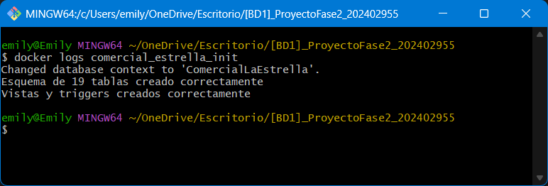

**Contenedores en ejecución (`docker ps`):** Muestra el contenedor `comercial_estrella_db` con SQL Server 2022 en estado `healthy` y el puerto 1433 expuesto.

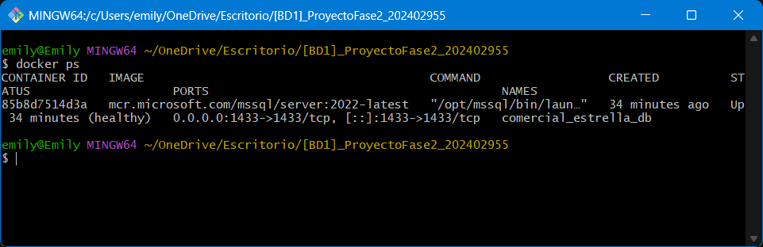

**Docker Desktop:** Muestra el proyecto de docker compose con sus dos servicios: `comercial_estrella_db` (SQL Server en ejecución) y `comercial_estrella_init` (que ejecuta `init.sql` y termina), junto con el estado de los contenedores.

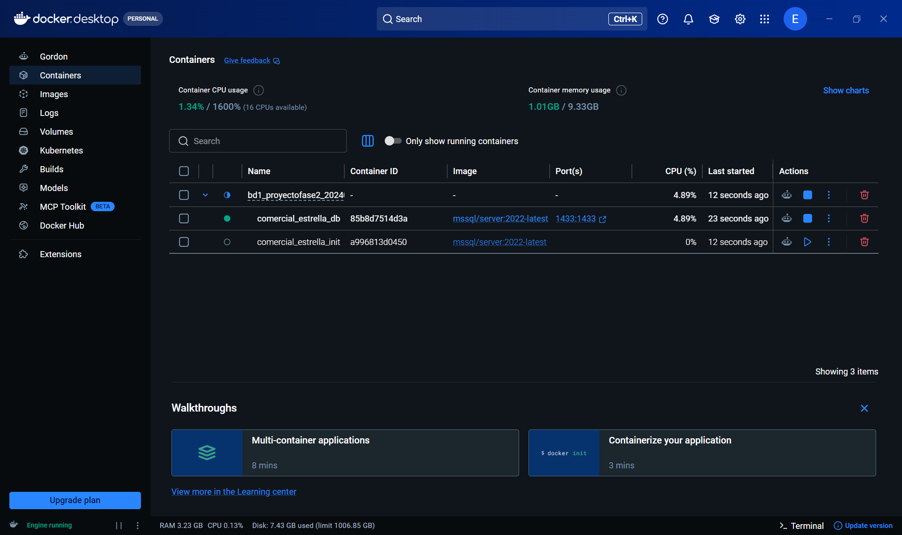

**API en ejecución:** Es la terminal del backend con el mensaje `Servidor corriendo en http://localhost:3000`, que confirma la conexión a SQL Server mediante las variables de entorno.

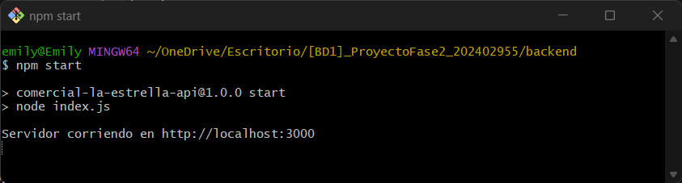

**Colección completa en el Runner de Postman:** A la izquierda se ve la estructura de la colección (carpetas 00 a 07) y arriba el resumen: 245 pruebas, 245 correctas, 0 fallidas, 0 errores. Las primeras peticiones son la carga masiva del dataset, todas con HTTP 201.

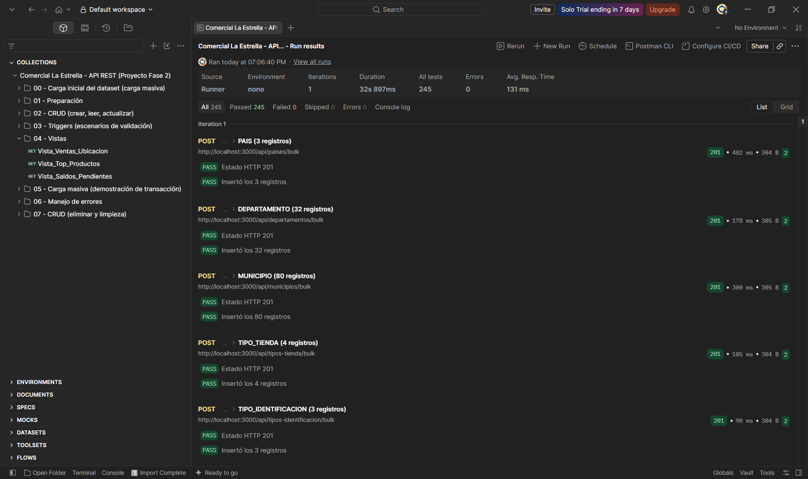

### 11.2 Trigger 1: Protección de Inventario

**Escenario 1 (fallo):** Se envía un POST a `/api/detalles-venta` pidiendo 999 unidades de un producto con existencia 5. El trigger rechaza la transacción y la API responde HTTP 400 con `{"error": "Stock insuficiente"}`. A la izquierda se ve que el GET posterior al catálogo confirma que la existencia sigue en 5.

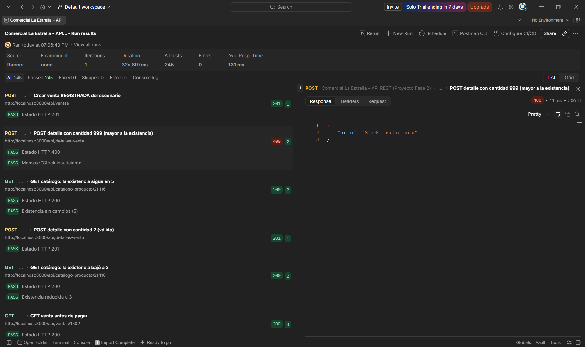

**Escenario 2 (éxito):** Se envía un POST con cantidad 2 y la API responde HTTP 201 (subtotal 71 = 2 x 35.50). El GET inmediato al catálogo muestra que la existencia bajó de 5 a 3, descuento hecho por el trigger.

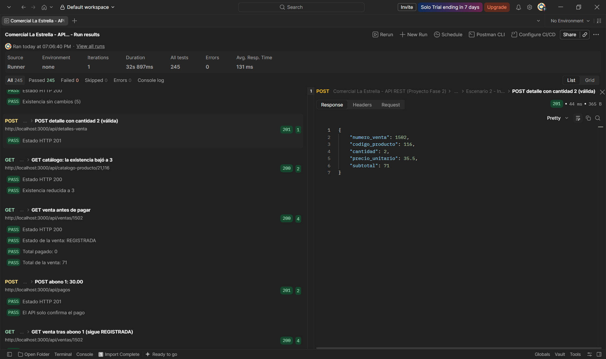

### 11.3 Trigger 2: Estado Automático de la Venta

**Abonos parciales:** Una venta REGISTRADA con total 71 y nada pagado recibe un primer abono de 30.00 y un segundo de 30.00. En ambos casos la API solo confirma el pago y los GET intermedios muestran que la venta sigue REGISTRADA con total pagado de 30 y luego de 60.

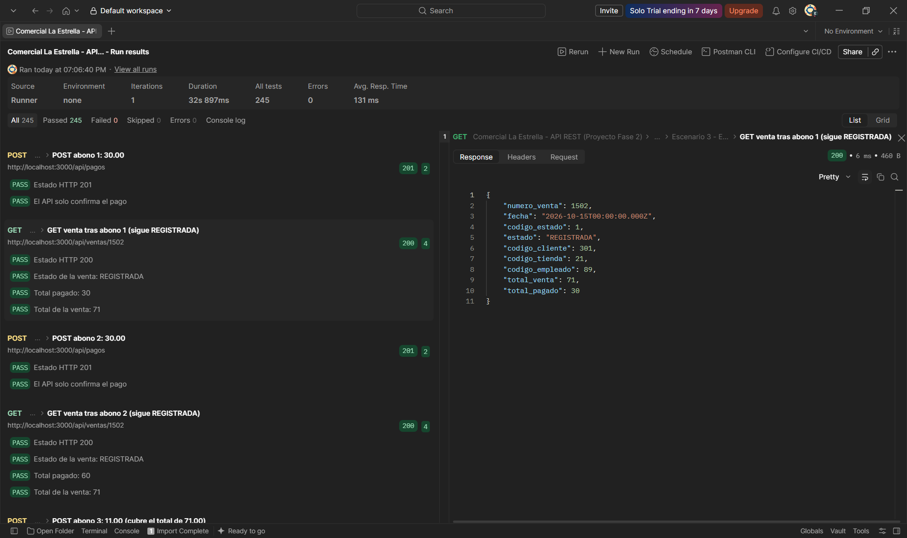

**Pago final:** Con el tercer abono de 11.00 la suma de pagos llega a 71, igual al total de la venta. El GET a la venta muestra `"estado": "PAGADA"` y `"total_pagado": 71`, siendo un cambio hecho por el trigger y no por la API.

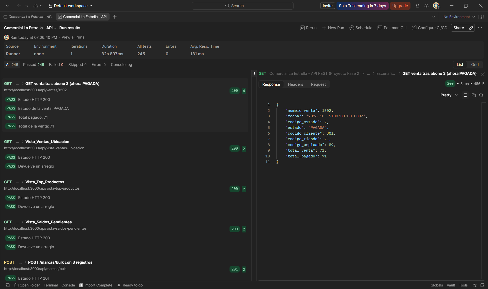

### 11.4 Vistas Analíticas

**`Vista_Ventas_Ubicacion`:** Devuelve por tienda su municipio, departamento, país, cantidad de ventas y total facturado, sin contar las ventas anuladas. Ejemplo: Comercial La Estrella Antigua (Zacapa, Guatemala) con 79 ventas y 76497.83 facturados. El endpoint solo ejecuta un SELECT sobre la vista.

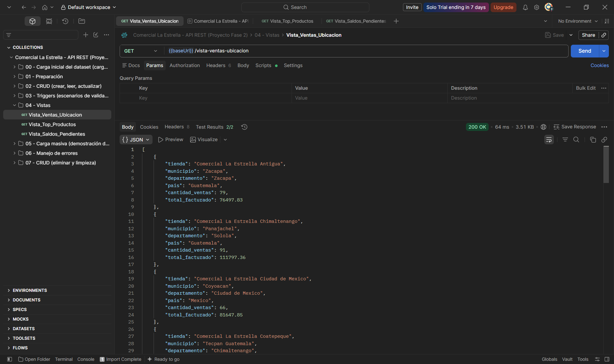

**`Vista_Top_Productos`:** Devuelve código, nombre, categoría, marca, unidades vendidas y monto generado por producto, sin contar las ventas anuladas. Ejemplo: Tortillas de maíz frito Especial con 162 unidades y 9623.54 generados.

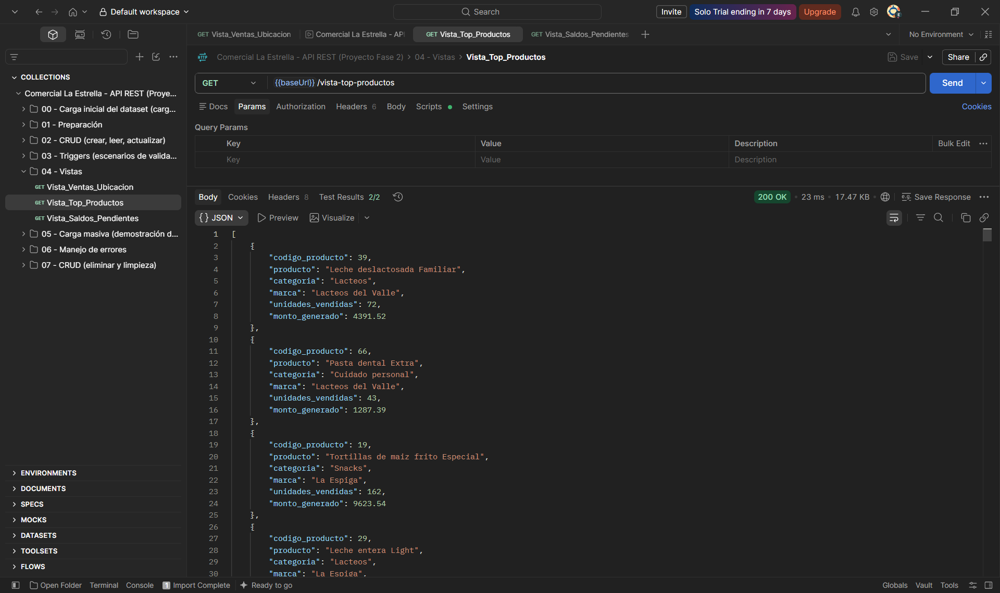

**`Vista_Saldos_Pendientes`:** Muestra solo las ventas en estado REGISTRADA con su total, lo pagado y la diferencia pendiente. Ejemplo: la venta 18 tiene un total de 1285.50, ha pagado 632.32 y debe 653.18.

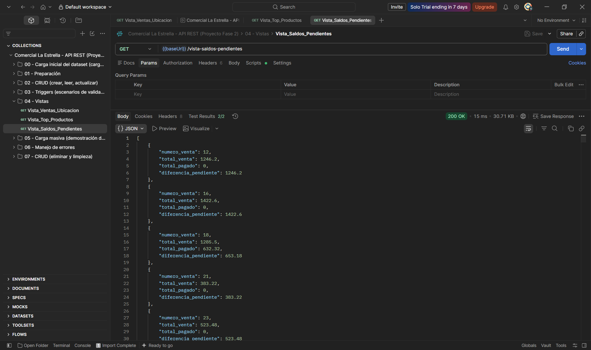

> **Nota:** Las respuestas de las vistas son demasiado largas, en cada captura se muestran solo las primeras filas.